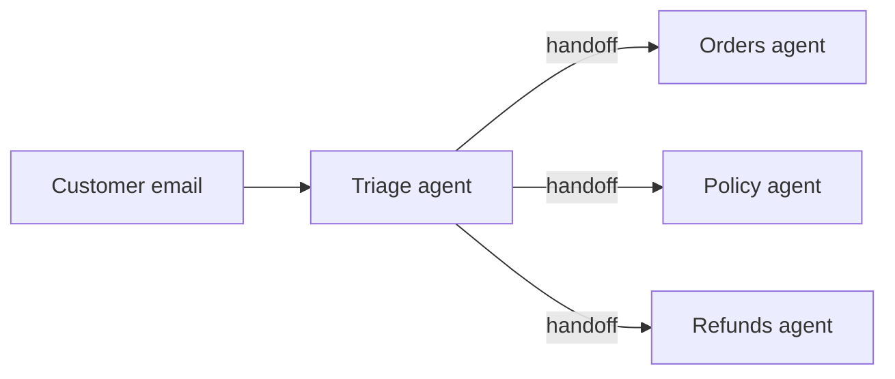
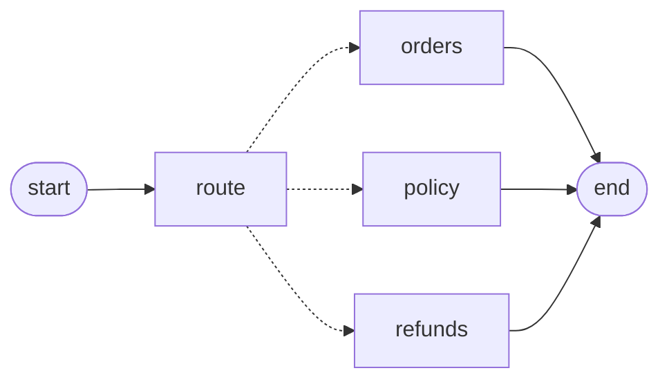
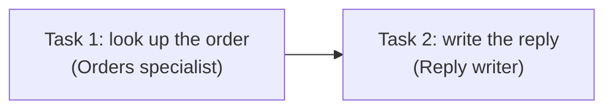

# Module 06 · Agent Frameworks: what they are, what they cost, and how to choose

In Modules 01 to 05 you built everything **by hand**: the tool descriptions, the agent loop, the router, memory, guardrails and evals. That was on purpose. You now know what is inside an agent.

Now you will meet the packages that do the repeated work for you, called **agent frameworks**. You will build the same support desk in three of the most popular ones and measure what each one gives and what each one costs.

We keep using the same online shop. Read this page first, then work through the notebooks in order.

**On this page**
[What is a framework?](#what-is-a-framework) · [Gives and costs](#what-a-framework-gives-you-and-what-it-costs) · [The map](#the-map-of-frameworks) · [Three ideas](#three-ways-of-thinking-handoffs-graphs-crews) · [Which to pick](#which-one-should-you-pick) · [Rules of thumb](#rules-of-thumb) · [The notebooks](#the-notebooks)

---

## What is a framework?

Every agent project needs the same plumbing:

| Job | In Modules 02 to 04 you... |
|---|---|
| Describe each tool to the model | wrote a block of JSON per tool |
| Run the agent loop | wrote `run_agent` |
| Route to the right specialist | wrote a router function |
| Keep state, pause, resume | stored it yourself |
| See what happened | printed it yourself |

A **framework** is that plumbing written once and tested by many people. You describe **what** your agents are, and the framework handles **how** they run.

In `shop_tools.py` the tools are plain Python functions with a docstring and type hints. Each framework builds the model's tool description **from the function**. The ten lines of JSON per tool disappear.

---

## What a framework gives you, and what it costs

| Gives you | Costs you |
|---|---|
| Tool descriptions built from your functions | **A new vocabulary** to learn (agents, runners, nodes, crews) |
| A tested agent loop | **Hidden prompts**, so more tokens than you expect |
| Handoffs, graphs or crews for several agents | **Churn**: many are below version 1.0 and change between releases |
| State, checkpoints, pause and resume | **Harder debugging**: bugs can live in code you did not write |
| Tracing, streaming, retries | **Lock-in**: your agents are written in one framework's style |
| Hooks to attach guardrails | **Heavy installs** (CrewAI pulls in many packages) |

Neither column wins by itself. The right question is: **does what it gives solve a problem I actually have?**

---

## The map of frameworks

Frameworks differ in **how they think about an agent system**.

| Kind | The idea | Examples | Good for |
|---|---|---|---|
| **Lightweight agent SDKs** | A few building blocks: agent, tool, handoff | **OpenAI Agents SDK**, Pydantic AI, Claude Agent SDK, Google ADK | Getting an agent running quickly |
| **Graph / workflow engines** | You draw the flow: boxes and arrows with shared state | **LangGraph** | Control, loops, saved progress, human approval |
| **Role-based teams** | Agents with a role, goal and backstory work through tasks | **CrewAI** | Work that reads like a team doing a job |
| **Conversation-based** | Agents chat with each other to solve a problem | AutoGen (now in maintenance mode; Microsoft points new projects to Microsoft Agent Framework) | Research and experiments |
| **Low-code / visual** | Drag and drop on a canvas | n8n, Flowise, Dify | Teams that do not want to write code |
| **Data-first** | Built around your documents | LlamaIndex | Retrieval-heavy apps |

We study **three**: the OpenAI Agents SDK, LangGraph and CrewAI. They are among the most popular and each one stands for a different idea.

> Product names on this map change quickly. **Learn the ideas** (handoff, graph, crew). Every new framework is a mix of them.

---

## Three ways of thinking: handoffs, graphs, crews

### OpenAI Agents SDK: handoffs
An **agent** is a name, instructions and tools. A **handoff** passes the customer from one agent to another. A **runner** runs the loop.



The model decides who gets the email. Fewest ideas to learn, least visibility into the routing.

### LangGraph: a graph you draw
**State** is a shared notebook. **Nodes** are steps. **Edges** are arrows. A **conditional edge** picks the next node by reading the state.



You decide the flow, so it is predictable and testable. It can **save its state, pause for a human and resume**. You write more of the structure yourself.

### CrewAI: a team
An **agent** has a role, goal and backstory. A **task** is a job. A **crew** works through the tasks, either in order or under a manager.



It reads like a job description. Manager mode saves code but uses many more tokens and is harder to predict.

---

## Which one should you pick?

| If you need... | Look at | Because |
|---|---|---|
| The quickest start on OpenAI models | **OpenAI Agents SDK** | Few ideas, tracing and handoffs built in |
| Control, branches, loops, human approval | **LangGraph** | You draw the flow, and state can be paused and resumed |
| A pipeline of roles (research, write, review) | **CrewAI** | Agents and tasks map to how people describe a team |
| One agent, full visibility, lowest cost | **Plain Python** | Nothing hidden |
| No code at all | **n8n, Flowise, Dify** | Visual canvas |

Notebook 05 runs the same desk in all four ways and **measures** correctness, tokens, time and lines of code.

---

## Rules of thumb

- **Start without a framework.** Add one when you feel the problem it solves.
- **Pick by the shape of your problem**, not by popularity.
- **Keep your business logic in plain functions** (`shop_tools.py`). Then switching frameworks only means rewriting a thin wrapper.
- **Pin versions** (see `requirements.txt`) and **run your evals after every upgrade**.
- **Use a separate environment** for frameworks. They pull in many packages and can clash with other projects.
- **Read the traces.** Whatever the framework, learn how to see which tools ran and how many tokens were spent.
- **A framework is not a safety system.** Guardrails (Module 05) are plain checks around the desk, and they work with any framework.

---

## The notebooks

All of them use only the OpenAI API (the frameworks call it for us). The shop is in [shop_tools.py](shop_tools.py) and the four desks are in [plain_desk.py](plain_desk.py), [agents_sdk_desk.py](agents_sdk_desk.py), [langgraph_desk.py](langgraph_desk.py) and [crewai_desk.py](crewai_desk.py). The notebooks show the important parts of that code.

| # | Notebook | You will learn |
|---|---|---|
| 1 | [01_WhyFrameworks.ipynb](01_WhyFrameworks.ipynb) | Count the plumbing you wrote by hand, see the map of frameworks, and when you do not need one |
| 2 | [02_OpenAIAgentsSDK.ipynb](02_OpenAIAgentsSDK.ipynb) | Agent, tool, runner and handoffs: the support desk with the lightest framework |
| 3 | [03_LangGraph.ipynb](03_LangGraph.ipynb) | State, nodes and edges, the desk as a graph, and pausing for human approval |
| 4 | [04_CrewAI.ipynb](04_CrewAI.ipynb) | Roles and tasks, a team of two, the desk as a crew, and why manager mode costs more |
| 5 | [05_SameDeskFourWays.ipynb](05_SameDeskFourWays.ipynb) | Run the same inbox through all four desks and compare correctness, tokens, time and code size |

**Real-life examples:** the same morning inbox of five customer emails goes through the support desk. Outcomes are checked in the shop's data (was a refund really created?).

| Script | What it does |
|---|---|
| [agents_sdk_desk.py](agents_sdk_desk.py) | The whole desk in **one file** with the OpenAI Agents SDK: build it, then run the inbox |
| [langgraph_desk.py](langgraph_desk.py) | The same, with **LangGraph** |
| [crewai_desk.py](crewai_desk.py) | The same, with **CrewAI** |
| [run_desk.py](run_desk.py) | Runs the inbox on **the framework you choose**, or on all four side by side, and prints correctness, tokens, time and lines of code |

```powershell
python "Agent Frameworks/agents_sdk_desk.py"
python "Agent Frameworks/langgraph_desk.py"
python "Agent Frameworks/crewai_desk.py"

python "Agent Frameworks/run_desk.py" all          # or: plain, sdk, langgraph, crewai
```

### Setup: a separate environment
This module needs its own virtual environment. Frameworks pull in many packages and need different versions of the `openai` library than Modules 01 to 05.

```powershell
python -m venv venv-frameworks
.\venv-frameworks\Scripts\Activate.ps1
pip install -r "Agent Frameworks/requirements.txt"
```

On macOS or Linux, activate it with `source venv-frameworks/bin/activate`. The versions in `requirements.txt` are **pinned** to the ones this module was tested with. In your notebook editor, choose the `venv-frameworks` environment as the kernel. You also need `OPENAI_API_KEY` in your `.env` file. Running everything costs a few cents.

---

**Next: Module 07, Production Deployment & Observability.** Then the **capstone** puts the Module 05 guardrails and evals around the support desk in each framework and compares real numbers.

*Agentic AI: From Zero to Live Production · Module 06 · [Rohit Nirantar](https://github.com/rohitnirantar)*
