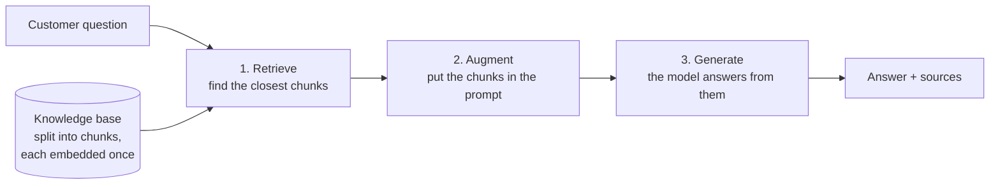
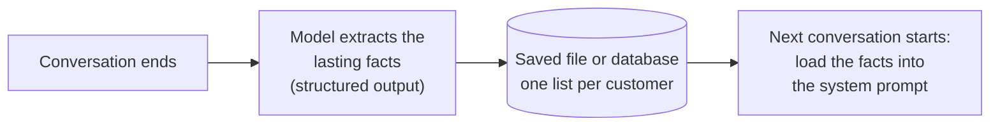

# Module 03 · Agent Memory & Retrieval: from forgetful to knowledgeable

At the end of Module 02 the agent could use tools, but it had two limits:

1. **It forgot everything** between conversations.
2. **It only knew what the model learned in training.** It had never seen your shop's policies.

This module fixes both. We keep using the same online shop and its support assistant.

Read this page first, then work through the notebooks in order.

**On this page**
[Short-term memory](#short-term-memory) · [Embeddings](#embeddings-search-by-meaning) · [RAG](#rag-answers-from-your-own-documents) · [Long-term memory](#long-term-memory) · [Putting it together](#putting-it-together) · [Rules of thumb](#rules-of-thumb) · [The notebooks](#the-notebooks)

---

## Short-term memory

From Module 01: the API has no memory, so you resend the conversation on every call. That message list **is** the agent's short-term memory.

The catch is that it grows. Every old message is billed again on every call, answers get slower, and eventually the conversation no longer fits in the model's **context window** (its maximum input size).

| Approach | Cost | What is lost |
|---|---|---|
| Send everything | Grows every turn | Nothing, until it no longer fits |
| **Trim** (keep the last N messages) | Steady | Anything older than N |
| **Summarise** older messages | Steady | Fine detail, but key facts stay |

Short-term memory lives only while the conversation lasts.

---

## Embeddings: search by meaning

How do you find the right paragraph in a pile of documents? Matching words is fragile. A customer who writes "get my money back" will not match a paragraph about "refunds".

An **embedding** turns a text into a long list of numbers that captures its **meaning**. Texts that mean similar things get similar numbers, so we can score how close two texts are.

| Customer question | Policy sentence | Similarity |
|---|---|---|
| "How do I get my money back?" | "Refunds go back to the original payment method." | **High** |
| "How do I get my money back?" | "Standard shipping takes 3 to 5 business days." | Low |

The refund sentence wins even though they share almost no words. That is search by meaning.

---

## RAG: answers from your own documents

**RAG** stands for Retrieval-Augmented Generation. It lets the model answer from documents it has never seen, with no retraining.



1. **Prepare once.** Split each document into **chunks** (here, one paragraph each) and embed every chunk.
2. **Retrieve.** Embed the question and pick the chunks with the highest similarity.
3. **Augment.** Put those chunks in the prompt with the instruction "answer using only this".
4. **Generate.** The model writes the answer, and you can show which files it came from.

Why it matters:
- Without RAG the model **guesses** ("restocking fees are usually 15 to 20%").
- With RAG it answers from **your** policy ("10%").
- When the policy changes, you edit a text file. Nothing is retrained.
- If the answer is not in the documents, the model should say **"I don't know"**.

---

## Long-term memory

Short-term memory disappears when the program stops. **Long-term memory** saves important facts **outside the conversation** so a brand new session can load them.



| Short-term memory | Long-term memory |
|---|---|
| The message list | Facts saved to a file or database |
| Lasts one conversation | Lasts across conversations |
| Everything said | Only the lasting facts: name, preferences, past issues |

We do not save whole conversations. We ask the model for the few facts worth keeping, such as "prefers email over phone".

---

## Putting it together

By the end, one assistant has all of this:

| Ability | Where it comes from |
|---|---|
| Looks up a customer's orders | A **tool** (Module 02) |
| Answers policy questions | **RAG** over the knowledge base, offered to the agent as a tool |
| Follows the conversation | **Short-term memory** (the message list) |
| Recognises returning customers | **Long-term memory** (saved facts) |
| Pulls facts out of a conversation | **Structured output** (Module 02) |

---

## Rules of thumb

- **Retrieval quality decides answer quality.** If the wrong chunks are found, the answer is wrong however good the model is. Test with real questions.
- **The model chooses the search words.** A vague search can miss a detail, so tell the model to search each part of a question separately, and return a few more results than you think you need.
- **Tell the model to use only the retrieved text,** and to say "I don't know" otherwise. Show the sources so people can check.
- **Keep documents up to date.** An old policy file gives old answers with great confidence.
- **Treat retrieved text as untrusted.** A document could contain instructions. It is data to read, not orders to follow.
- **Memory is personal data.** Store as little as possible, never store payment details or passwords, keep each customer's memory separate, and let people delete it.
- **Tools must respect who is asking.** The order tool in this module only returns orders that belong to the current customer.

---

## The notebooks

All of them use only the OpenAI API and plain Python. The shop's policy files are in `knowledge_base/`.

| # | Notebook | You will learn |
|---|---|---|
| 1 | [01_ShortTermMemory.ipynb](01_ShortTermMemory.ipynb) | Use the message list as memory, then fix its growth by trimming and summarising |
| 2 | [02_Embeddings.ipynb](02_Embeddings.ipynb) | Turn text into vectors and build a tiny search by meaning |
| 3 | [03_SimpleRAG.ipynb](03_SimpleRAG.ipynb) | Answer from the knowledge base: retrieve, augment, generate, with sources |
| 4 | [04_LongTermMemory.ipynb](04_LongTermMemory.ipynb) | Save facts to a file, load them in a new session, and let customers be forgotten |
| 5 | [05_RAGAsATool.ipynb](05_RAGAsATool.ipynb) | Give the agent a knowledge base search tool and watch it choose between tools |

**A real-life example:** [support_assistant.py](support_assistant.py) is the shop's support assistant with everything combined. It runs three conversations. Priya chats and her facts are saved. Priya returns and is remembered. A different customer, Rahul, chats and cannot see Priya's memory or orders.

```powershell
python "Agent Memory and Retrieval/support_assistant.py"
```

**Setup:** the same as before. You need `OPENAI_API_KEY` in your `.env` file. Embeddings cost a tiny fraction of a cent, and each notebook makes only a handful of small calls.

---

**Next: Module 04, Multi-Agent Architectures.** One assistant can only do so much. Next, several specialised agents (for example one for orders, one for policy, one for escalations) work together and hand tasks to each other.

*Agentic AI: From Zero to Live Production · Module 03 · [Rohit Nirantar](https://github.com/rohitnirantar)*
