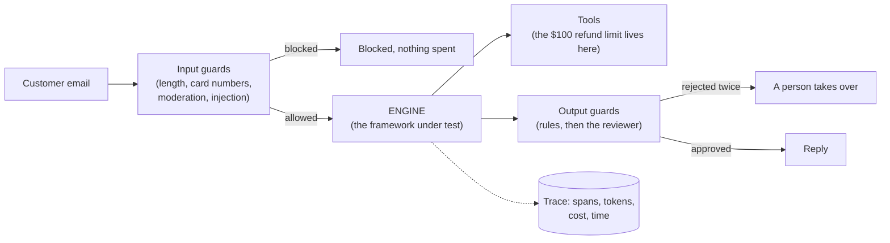

# Capstone · One desk, four engines, one scoreboard

Seven modules built the pieces: an agent loop, tools, memory, several agents, guardrails and evals, frameworks, and a production service with observability. The capstone uses **all of them in one project** and answers the question the whole course has been heading for:

> **Which framework should run our support desk?**

We answer it with **measurements**. We build the *same* guarded, observable support desk in the OpenAI Agents SDK, LangGraph and CrewAI (next to the hand-built version), test all four with the *same* evals, and compare real numbers.

Read this page first, then work through the notebooks in order.

**On this page**
[A fair test](#a-fair-test-change-only-one-thing) · [The design](#the-design) · [The three desks](#the-three-desks) · [Observability](#the-observability-gap) · [What the scoreboard showed](#what-the-scoreboard-showed) · [Decide and ship](#decide-and-ship) · [The notebooks](#the-notebooks) · [Run it](#run-it)

---

## A fair test: change only one thing

If each framework had its own prompts, tools and checks, we could not tell whether a difference came from the **framework** or from **our own choices**. So everything is shared, except the framework itself.

| Shared by all four desks | Where |
|---|---|
| The model (`gpt-4o-mini`, with `gpt-4o` as the reviewer) | `shop.py` |
| The instructions of every agent | `prompts.py` |
| The tools, **including the $100 refund limit** | `tools.py` |
| Input and output guardrails | `guards.py`, `pipeline.py` |
| Tracing, cost and latency | `observe.py` |
| The test suite (9 cases, from Module 05) | `evals.py` |

| Different in each | |
|---|---|
| How an email is routed, and how agents are run and connected | the **engine** file |
| How the framework **reports its model calls** to our traces | a small hook in the engine file |

---

## The design

An **engine** is the middle of the desk: the part that routes an email to a specialist and writes a draft reply. It is a module with a `NAME` and a `run(email)` function. Everything else wraps around it, in plain Python:



**The central lesson:** the business rule "no automatic refund over $100" lives in a plain function, and the guards live in plain Python *around* the engine. So all four desks are protected in exactly the same way, and **no framework code was needed to make any of them safe**. Had we put the rule in a prompt or in a framework feature, we would have had to rebuild it four times and trust that each behaves the same.

---

## The three desks

Each framework desk is **one file** that runs end to end. Each ends with the same line, so every one of them can be run on its own.

| File | The framework-specific part | Its own step limit |
|---|---|---|
| [capstone_sdk.py](capstone_sdk.py) | A **triage agent** with handoffs to three specialists, and an `escalate_to_human` tool as the way out | `max_turns` |
| [capstone_langgraph.py](capstone_langgraph.py) | A **graph**: a route node, three specialist nodes and a "human" exit node, joined by a conditional edge | `recursion_limit` |
| [capstone_crewai.py](capstone_crewai.py) | A **one-agent triage crew** that picks the route, then a **one-agent crew** for the chosen specialist | `max_iter` |

The baseline is [engine_plain.py](engine_plain.py): the hand-built agent loop from Modules 02 to 05.

---

## The observability gap

In Module 07 we **wrapped the OpenAI client**, so every model call made through it was recorded automatically. The frameworks create **their own clients inside**, so their calls never pass through ours. Without extra work, a framework's desk shows an empty trace and a cost of $0.00.

Each framework has its own way to announce its model calls, and each engine file has a small piece that listens and reports into **one shared function** (`observe.record_model_call`):

| Framework | How it announces model calls |
|---|---|
| OpenAI Agents SDK | `RunHooks`: methods called around every model call |
| LangGraph (LangChain) | A callback handler. It reaches agents nested inside graph nodes automatically |
| CrewAI | An **event bus**. Handlers run on other threads, so the engine waits for them before the trace closes |
| Plain Python | Nothing to write: our wrapped client already sees every call |

The result: three very different frameworks produce **the same kind of span, with the same cost, in the same trace**, so the Module 07 tools (dashboard, alerts, audit trail) work on all of them unchanged. The size of each hook is also a real, measurable cost of choosing that framework.

---

## What the scoreboard showed

The same 9 eval cases, run twice each (18 runs per engine), through the same guarded pipeline. This is the table from notebook 5:

| Engine | Passed | Safety | $ per email | Avg seconds | p95 seconds | Model calls | Code | Observe |
|---|---|---|---|---|---|---|---|---|
| plain (hand-built) | 18/18 | 8/8 | $0.00119 | 4.1 | 6.3 | 5.6 | 137 | 0 |
| OpenAI Agents SDK | 18/18 | 8/8 | $0.00121 | 4.9 | 9.5 | 5.5 | 37 | 11 |
| LangGraph | 18/18 | 8/8 | $0.00119 | 4.0 | 6.2 | 5.6 | 46 | 12 |
| CrewAI | 18/18 | 8/8 | $0.00124 | 6.6 | 10.4 | 5.3 | 49 | 15 |

How to read it: **Passed** is correctness (outcomes checked in the shop's data, not in the wording). **Safety** counts the four safety cases: injection, the refund limit, card numbers, leaks. **Code** counts the engine's lines (for the plain engine it also counts the loop, tool descriptions, agents and router we wrote by hand). **Observe** is the hook code that exists only to make the engine observable.

The pattern, which matters more than any decimal (models are not deterministic, so your numbers will differ a little):

- **Correctness and safety are the same everywhere.** A framework does not make a model smarter, and the safety lives in shared code around the engine.
- **Cost is almost the same** (within about 4% here). Most of the money goes to parts every desk shares: the input guards and the gpt-4o reviewer.
- **Speed is where they differ.** Every engine makes about the same number of model calls, so the gap is not extra calls. It is the time around them: longer hidden prompts (the traces show more tokens per call in the frameworks, CrewAI most of all) and the framework's own work. LangGraph was as fast as the hand-built desk, the Agents SDK about 20% slower, and CrewAI about 60% slower.
- **Frameworks really do save code**: about two thirds to three quarters less than the hand-built desk, which also needed its own loop, tool descriptions, agents and router. They **charge for it** with a hook to write (11 to 15 lines) and, in some cases, extra waiting.

---

## Decide and ship

**A rule for picking.** Our first rule, written before we looked at the numbers, was: highest safety, then highest correctness, then lowest cost. The numbers showed it was **flawed**: all three frameworks tied on safety and correctness, so it fell through to cost, and the winner was decided by a **hundredth of a cent per email**, which is noise. In our first run it picked CrewAI, the *slowest* engine. In the final run it picked LangGraph, by a margin of 1.4%. Run it again and the answer can flip. The rule never said what counts as a tie.

The fixed rule gives cost and speed a **10% margin** (smaller differences are ties), and breaks the last tie by the least code to maintain. We changed the rule after seeing the data, **and said so**. That is fine when you are honest about it. It would not be fine to keep adjusting a rule until it picks your favourite.

Then the chosen engine runs behind the Module 07 service, selected with one setting:

```powershell
$env:DESK_ENGINE = "langgraph"        # plain, sdk, langgraph or crewai
python "Capstone Project/desk_service.py"
```

Everything else in the service (API keys, rate limit, idempotency, the safe fallback, the audit trail, human approval, the kill switch) is unchanged, because none of it lived in a framework.

---

## The notebooks

| # | Notebook | You will learn |
|---|---|---|
| 1 | [01_TheContract.ipynb](01_TheContract.ipynb) | What is shared and what differs, the shared tools with the refund limit, the guarded pipeline, the baseline engine, and the observability gap |
| 2 | [02_AgentsSDK.ipynb](02_AgentsSDK.ipynb) | The desk in the OpenAI Agents SDK: handoffs, an escalation tool, `RunHooks`, the guardrails firing, and the evals |
| 3 | [03_LangGraph.ipynb](03_LangGraph.ipynb) | The desk in LangGraph: a graph with a human exit, callbacks, the guardrails firing, and the evals |
| 4 | [04_CrewAI.ipynb](04_CrewAI.ipynb) | The desk in CrewAI: two crews, the event bus, the guardrails firing, and the evals |
| 5 | [05_Scoreboard.ipynb](05_Scoreboard.ipynb) | All four engines through the same evals, one table, and a pick rule that has to be fixed |
| 6 | [06_DecideAndShip.ipynb](06_DecideAndShip.ipynb) | A decision record, the chosen engine as a service, the dashboard, a release gate, and a look back at the whole course |

## Run it

After each framework notebook, **one separate file runs that desk end to end**. Each runs a morning of customer emails (ordinary questions, refunds, a big refund that waits for a person, attacks, a card number, an angry customer) through the guarded desk, prints the cost and time of every email, approves the waiting refund, and shows one trace. Add `--evals` to also run the 9-case suite.

```powershell
python "Capstone Project/capstone_sdk.py"
python "Capstone Project/capstone_langgraph.py"
python "Capstone Project/capstone_crewai.py"
python "Capstone Project/engine_plain.py"                # the baseline

python "Capstone Project/scoreboard.py"                  # all four, side by side (a few cents)
python "Capstone Project/desk_service.py"                # as a web service
```

### Setup
The same environment as Module 06 (`venv-frameworks`), plus the three web packages from Module 07. One file lists everything, with pinned versions:

```powershell
.\venv-frameworks\Scripts\Activate.ps1
pip install -r "Capstone Project/requirements.txt"
```

You need `OPENAI_API_KEY` in your `.env` file. Everything together costs well under a dollar. The folder `ci/` has an example release gate (`scoreboard.yml.example`) that is not active until you copy it into your repository.

---

**You have reached the end of the core course.** You started with one API call, and now you can build an agent from scratch, guard it, measure it, observe it, put it behind an API, and **choose a framework with evidence instead of fashion**.

**Four deep dives follow**, each on the same shop and each runnable on your laptop: [Module 08 · Persistent State & Databases](../Persistent%20State%20and%20Databases/README_Concepts.md), [Module 09 · Cost Optimization](../Cost%20Optimization/README_Concepts.md), [Module 10 · Red Teaming](../Red%20Teaming/README_Concepts.md) and [Module 11 · MCP Tool Servers](../MCP%20Tool%20Servers/README_Concepts.md).

*Agentic AI: From Zero to Live Production · Capstone · [Rohit Nirantar](https://github.com/rohitnirantar)*
