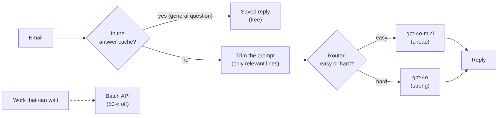

# Module 09 · Cost Optimization: make it cheaper without making it worse

A cent per email sounds like nothing. But the desk answers emails all day, and **a cent, repeated, is a bill**. This module takes the same support desk and makes it cheaper, using four levers: **choose the model**, **don't pay twice** (caching), **send less**, and **wait for a discount** (batching).

One rule runs through the whole module:

> **No optimisation without a measurement.** Every trick must show, on the same emails, what it saved **and** whether the answers stayed correct. An optimisation that makes the answers worse is not an optimisation.

Read this page first, then work through the notebooks in order.

**On this page**
[How a call is priced](#how-a-call-is-priced) · [The test set](#the-test-set-measure-quality-first) · [The four levers](#the-four-levers) · [What the measurements showed](#what-the-measurements-showed) · [Honest limits](#what-this-module-does-not-do) · [The notebooks](#the-notebooks) · [Run it](#run-it) · [Interview corner](#interview-corner)

---

## How a call is priced

You pay **per token** (about three quarters of a word), at three prices, in dollars per million tokens:

| | Input | Cached input | Output |
|---|---|---|---|
| `gpt-4o-mini` | $0.15 | $0.075 | $0.60 |
| `gpt-4o` | $2.50 | $1.25 | $10.00 |

Two facts shape everything: **output costs 4 times more than input**, and **`gpt-4o` costs about 16 times more than `gpt-4o-mini`**. (Prices change. They live in one table, `PRICES` in `llm.py`.)

On this desk **most of the tokens are input**: the shop's handbook (about 1,170 tokens) travels with every email. Where the tokens are is where the savings are.

---

## The test set: measure quality first

You cannot make something cheaper without knowing it is still good. Each of the 28 test emails in `inbox.py` has a list of **facts** that a correct reply must contain. The score is the share of facts present. It is a plain text check: cheap, repeatable, no extra model call.

- **12 easy** emails: one simple question ("How much does express shipping cost?").
- **16 hard** emails: several questions at once, arithmetic that combines two rules, or a case where **a person must take over** (a lawyer threat, a card number, a request for an exception).

**A confession.** We first wrote 24 emails, and the cheap model passed **all** of them. A test set that nothing can fail teaches you nothing. So we added four emails with arithmetic that combines two rules, and the cheap model then slipped on some. Real test sets grow exactly like this: from failures.

---

## The four levers



| # | Lever | How it works | Risk |
|---|---|---|---|
| 1 | **Routing** | A cheap router reads each email and picks the model. The router's own call is part of the bill | A hard email sent to the cheap model gets a cheap, **wrong** answer |
| 2 | **Prompt caching** | OpenAI reuses a long prompt start it has just seen, at about half price. **Automatic**: you only keep the static part first and the changing part last | none |
| 3 | **Answer caching** | Exact (same question, any capitals or spacing) and semantic (same meaning). Saves the whole call | A semantic cache can return a **wrong or leaked** answer: "order A1001" and "order A1002" look almost identical to an embedding |
| 4 | **Trimming** | Send only the handbook lines that match the email (RAG, from Module 03, as a cost tool) | If the search misses the right paragraph, the model has nothing to answer from |
| 5 | **Batching** | The Batch API takes a file of requests and charges 50% less, within 24 hours | Only for work that can wait |

Smaller levers: `max_tokens` (output is 4 times dearer than input, but too low a ceiling cuts replies in half), asking for short replies, and a tighter handbook.

---

## What the measurements showed

A day of traffic: 28 different emails plus 8 repeats, 36 emails. These are the numbers from `cost_report.py` and notebook 5 (yours will differ a little; models are not fully deterministic):

| Setup | $ per 1,000 emails | Replies with every fact | Avg seconds | Saved | At 30,000 emails/month |
|---|---|---|---|---|---|
| **A** `gpt-4o` for everything | $1.88 | 36 / 36 | 0.7 | 0% | $56 |
| **B** `gpt-4o-mini` for everything | $0.11 | 35 / 36 | 0.8 | 94% | $3 |
| **C** routed (easy → mini, hard → 4o) | $1.07 | 36 / 36 | 1.4 | 43% | $32 |
| **D** C + answer cache | $1.01 | 36 / 36 | 1.2 | 46% | $30 |
| **E** D + trimmed prompt | $0.45 | 31 / 36 | 1.2 | 76% | $14 |

How to read it:

1. **A to B: the biggest saving is simply the cheapest model**, at the price of a miss on arithmetic. Is that acceptable? It is a **business** decision (how bad is a wrong shipping price?), not a technical one.
2. **A to C: routing keeps the quality and saves about 40 to 45 percent.** It does not reach B because most of the hard emails (16 of 28) go to the strong model, and the router's own call is not free.
3. **C to D: the cache saves only a few percent**, within the run-to-run noise. Most of the traffic is personal (the guard refuses to cache it), and most calls a cache can remove are cheap calls. **An optimisation that barely pays is a real result. Report it.**
4. **D to E: trimming saves the most, and it is where quality drops** (31 of 36). It is the riskiest lever. Never ship it without a test set.

**What we would ship:** setup **C**. The quality of the strong model, about half the price, and no risky parts. The best optimisation is rarely the one with the biggest number. It is **the biggest saving you can trust**.

---

## What this module does not do

- **It is one small workload.** 28 emails is enough to teach the method, not to prove a ranking. Real teams measure on hundreds or thousands of real emails.
- **Prices and models change.** A newer, cheaper model may make all of this moot. The *method* (test set, measure, compare) does not expire.
- **Our router is cautious.** It sends many emails to the strong model that the cheap one could have answered. A **cascade** (try the cheap model, check the answer, escalate only on failure) would save more and is harder to build well.
- **Quality is a fact check.** It does not measure tone or helpfulness. For that you add an LLM judge (Module 05).
- **Latency was not optimised.** Routing adds a call. Streaming and parallel calls are separate topics.

---

## The notebooks

| # | Notebook | You will learn |
|---|---|---|
| 1 | [01_WhereTheMoneyGoes.ipynb](01_WhereTheMoneyGoes.ipynb) | How a call is priced, where the tokens go, and how to measure quality with a test set |
| 2 | [02_TheRightModelForTheJob.ipynb](02_TheRightModelForTheJob.ipynb) | Rules router vs LLM router, measuring a router, and always-strong vs always-cheap vs routed |
| 3 | [03_DontPayTwice.ipynb](03_DontPayTwice.ipynb) | Prompt caching (and the order that breaks it), exact cache, semantic cache and its danger |
| 4 | [04_DontPayFullPrice.ipynb](04_DontPayFullPrice.ipynb) | Trimming the prompt (and its quality cost), the Batch API with a real batch |
| 5 | [05_PutItTogether.ipynb](05_PutItTogether.ipynb) | Five setups, one table, and a monthly bill |

## Run it

After the notebooks, **one file runs the whole scenario** ("the finance team says the desk costs too much"): five setups on the same day of traffic, one table.

```powershell
python "Cost Optimization/cost_report.py"                 # about 4 minutes, about 20 cents
python "Cost Optimization/batch.py" prepare               # write a batch file, see what it would cost
python "Cost Optimization/batch.py" submit                # start a real batch (a few cents)
python "Cost Optimization/batch.py" check <batch id>
python "Cost Optimization/batch.py" results <batch id>
```

### Setup
The main environment from the repository's [README](../README.md) is enough: `openai`, `pydantic`, `python-dotenv` and `jupyter`. You need `OPENAI_API_KEY` in your `.env` file. The whole module costs about 50 cents.

---

## Interview corner

**The 30-second story.** *"I cut my support agent's cost by measuring first. I built a test set of 28 emails with required facts, found that the cheap model was 16 times cheaper but slipped on arithmetic, and added a router that sends only the hard emails to the strong model: 43% cheaper, same quality. I also tried a semantic cache and found it barely paid, and a trimmed prompt that saved the most but dropped quality. I reported both honestly and shipped the routed version."*

**Questions you may get, and short answers**

| Question | A good short answer |
|---|---|
| How would you reduce the cost of an LLM app? | Measure first. Then: a cheaper model where a test set says it is good enough, routing by difficulty, caching, shorter prompts, batching what can wait. Check quality after each. |
| What is model routing? | A cheap classifier picks the model per request. The router's own cost counts, and you must measure its mistakes: a hard task sent to a weak model is a wrong answer. |
| What is prompt caching? | The provider reuses a long, unchanged prompt prefix at a discount. Keep static content first and changing content last. |
| Exact cache vs semantic cache? | Exact is safe. Semantic matches by meaning using embeddings, so it can return a wrong answer for similar-looking questions, so it needs a measured threshold and a guard that keeps personal or numeric questions out. |
| What is the danger of a semantic cache? | Two questions that look the same and need different answers ("order A1001" vs "order A1002"). That is a wrong answer at best, a data leak at worst. |
| When is the Batch API the right tool? | Work with no one waiting: overnight re-scoring, labelling, summaries. 50% cheaper, results within 24 hours. Never for a live customer. |
| What is a cascade? | Try the cheap model first, check the answer, escalate only if the check fails. Saves more than routing, harder to build. |
| How do you know an optimisation did not hurt quality? | A test set with required facts or a judge, run before and after on the same inputs. |
| Output tokens vs input tokens? | Output costs about 4 times more per token, so asking for short replies saves real money. But a `max_tokens` ceiling that is too low cuts replies in half. |

**A good question to ask them back:** *"Do you have a test set you re-run when you change a model or a prompt, so cost savings never silently cost quality?"*

---

**Next:** Module 10 attacks the desk on purpose, to find the holes before a stranger does.

*Agentic AI: From Zero to Live Production · Module 09 · [Rohit Nirantar](https://github.com/rohitnirantar)*
