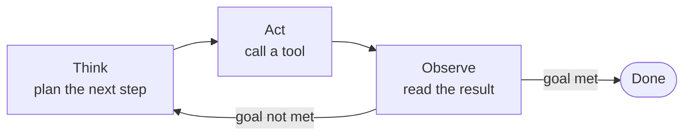

# Module 01 · Basic Setup: from ChatGPT to your own API calls

ChatGPT is a product. An API lets your own code use the model behind it. Every AI agent is built on API calls, so this is where the series starts.

Read this page first, then open the notebook: [01_BasicSetup.ipynb](01_BasicSetup.ipynb).

`Python` `OpenAI` `OpenRouter` `Gemini` `LangChain`

**On this page**
[Generative AI API](#what-is-a-generative-ai-api) · [Agentic AI](#what-is-agentic-ai) · [ChatGPT vs the API](#chatgpt-vs-the-api) · [What the notebook shows](#what-the-notebook-shows) · [Run it yourself](#run-it-yourself)

---

## What is a Generative AI API?

A generative model (GPT, Gemini, Llama) creates new text, images or code from a prompt. A Generative AI API is the doorway that lets your code talk to that model.

You send an HTTP request that holds your prompt and an API key. The provider runs the model and sends back a response your program can use: save it, parse it, or pass it to the next step.

> [!NOTE]
> **Analogy.** ChatGPT is the dining room, where you sit down and talk to a waiter. The API is the kitchen's order window. You can place orders from any program you write, as many as you like, in any format you choose.

---

## What is Agentic AI?

A normal model call is one question and one answer. Agentic AI wraps the model in a loop so it can work toward a goal on its own.



1. **Think.** Understand the goal and plan the next step.
2. **Act.** Call a tool: search the web, run code, query a database, call another API.
3. **Observe.** Read what the tool returned.
4. **Repeat.** Adjust the plan until the goal is met.

| | Plain LLM / chatbot | Agentic AI |
|---|---|---|
| **Interaction** | You ask, it answers | You give a goal, it works toward it |
| **Steps** | One | Many, in a loop |
| **Tools** | None | Search, code, files, APIs |
| **Memory** | Only what you paste in | Short-term and long-term |
| **Who drives** | You | The agent, within guardrails |

> [!NOTE]
> **Why this notebook comes first.** Every agent is built from API calls. Before you can build the loop, you need to know how to authenticate and call a model from code.

---

## ChatGPT vs the API

Both reach the same kind of model. The difference is who handles everything around it.

| | ChatGPT (website or app) | API (this notebook) |
|---|---|---|
| **How you use it** | Type in a chat window | Write Python code |
| **Authentication** | Log in with email | API key stored in `.env` |
| **Cost** | Flat monthly subscription | Pay per token, input and output |
| **Memory** | Remembers the chat for you | Stateless. You resend the history |
| **Control** | A few settings | `model`, `temperature`, `max_tokens`, system prompt |
| **Model choice** | Whatever the app offers | Any model from any provider |
| **Output** | Text on a screen | Python objects to save, parse or chain |
| **Automation** | Manual | Scripts, apps, schedules, agents |
| **Tools** | Built-in features only | You decide what the model can use |

> [!TIP]
> **Key takeaway.** Every provider follows one pattern: key, model, messages, response. That pattern is the building block of every agent.

---

## What the notebook shows

Beyond the three provider calls, the notebook has six short demos. The outputs below come from a real run of `01_BasicSetup.ipynb` with `gpt-4o-mini`.

### Message roles

An API call takes a list of messages, and every message has a role. In ChatGPT you only type `user` messages and OpenAI writes the `system` message for you. With the API you write it, and it is the main lever for building a specific product or agent.

| Role | Written by | Purpose |
|---|---|---|
| `system` | You, the developer | Sets behaviour, tone and rules. Hidden from the end user. |
| `user` | The person, or your code | The actual request. |
| `assistant` | The model | Its earlier replies. |
| `tool` | Your code | The result of a tool the model asked to run (Module 02). |

```python
reply = llm.invoke([
    SystemMessage(content="You are a pirate. Answer in at most 2 sentences."),
    HumanMessage(content="What is an API?"),
])
```

Same question, two system messages, two different answers:

| System message | Answer |
|---|---|
| Pirate | "An API, or Application Programming Interface, **be** a set of rules that allows different software applications to communicate with each other…" |
| Terse engineer | "An API (Application Programming Interface) is a set of rules and protocols that allows different software applications to communicate and interact with each other." |

### The API has no memory

This is the biggest difference from ChatGPT. Every API call is independent. The model sees only the messages in that one request, and nothing is stored between calls. ChatGPT's app quietly resends the whole conversation each time. With the API, that is your job.

| Call | What was sent | Reply |
|---|---|---|
| **1** | "Hi! My name is Alex and I am learning Agentic AI." | "Hi Alex! That's great to hear! Agentic AI is an exciting field…" |
| **2**, no history | "What is my name?" (1 message) | ❌ "I'm sorry, but I don't have access to personal information about individuals…" |
| **3**, with history | user, assistant, user, ending in "What is my name?" | ✅ "Your name is Alex!" |

```python
history = [
    HumanMessage(content=intro),
    AIMessage(content=reply_1.text),      # the model's own earlier answer
    HumanMessage(content="What is my name?"),
]
reply_3 = llm.invoke(history)
```

### Why we need memory

Call 2 failed and call 3 worked. The only difference was that the conversation was sent again. At its simplest, that is all memory is. It matters for four reasons:

- **Models are stateless.** The model keeps nothing between requests and does not learn from your call.
- **Conversations need context.** "Fix that bug" or "make it shorter" only make sense if the model can see what *that* and *it* refer to.
- **Agents work over many steps.** An agent that plans, searches, reads and decides must remember what it already did, or it repeats itself.
- **You cannot send everything every time.** Each resent message costs tokens, and the context window is limited. Long histories get slow, expensive, and eventually do not fit.

| Memory type | What it is | Typical tool |
|---|---|---|
| **Short-term** | Recent messages in the current conversation | A message list, trimmed or summarised as it grows |
| **Long-term** | Facts and documents saved across sessions, retrieved when relevant | A vector database (RAG) |

You build both in Module 03.

### Token usage and cost

ChatGPT costs a flat monthly fee. The API bills per token. A token is a chunk of text, roughly three quarters of an English word. You pay for input tokens (everything you send, including the system prompt and history) and output tokens (what the model writes). Output costs more per token. Every response reports its usage in `usage_metadata`.

| | Tokens | Share of tokens | Cost | Share of cost |
|---|---:|---:|---:|---:|
| Input | 23 | 24% | $0.000003 | 7% |
| Output | 73 | 76% | $0.000044 | 93% |
| **Total** | **96** | | **$0.000047** | |

One call costs about $0.000047, so roughly $0.05 per 1,000 calls. Output is about three quarters of the tokens but about 93% of the cost, because each output token is four times the price of an input token at these rates.

> [!WARNING]
> **Check current prices.** The notebook uses example rates for `gpt-4o-mini` ($0.15 input and $0.60 output per million tokens). Providers change prices often, so confirm on the provider's pricing page.

This is also why memory is a cost decision. Every message in the history is billed again as input on each later call, and an agent makes many calls per task.

### Parameters

ChatGPT gives you few controls. The API gives you several. The notebook demonstrates two.

**`temperature`** controls randomness. The same prompt, "Suggest a name for a coffee shop run by robots", run three times at each setting:

| Run | `temperature = 0.0` | `temperature = 1.2` |
|---|---|---|
| 1 | BrewBot Café | Byte Brew |
| 2 | RoboBrew Café | BrewBot Cafe |
| 3 | BrewBot Café | CaffeinatedCircuit |

Use a low value for extraction, classification and agent decisions, where you want consistent answers. Use a high value for brainstorming and creative writing.

**`max_tokens`** is a hard length limit. The model is cut off the moment it hits it, even mid-sentence. The response metadata says why it stopped: `stop` means it finished, `length` means it was cut off.

| `max_tokens` | `finish_reason` | Output tokens | Answer |
|---:|---|---:|---|
| 15 | `length` | 15 | "The internet is a global network of interconnected computers that communicate with each other using" |
| 200 | `stop` | 56 | Complete two-sentence answer |

### Streaming

`.invoke()` waits until the whole answer is ready. `.stream()` yields small chunks as the model generates them. ChatGPT feels fast because it streams. The total time is about the same, but the time to first token is much shorter, and that is what makes an app feel responsive.

| Method | First text on screen | Finished |
|---|---:|---:|
| `invoke()` | 1.39 s | 1.39 s |
| `stream()` | **0.48 s** | 1.39 s (81 chunks) |

```python
for chunk in llm.stream(prompt):
    print(chunk.text, end="", flush=True)   # print each piece the moment it arrives
```

---

## Run it yourself

1. Create and activate a virtual environment.
2. Install the dependencies with `pip install -r requirements.txt`.
3. Copy `.env.example` to `.env` and paste in the keys you have. One provider is enough.
4. Open `01_BasicSetup.ipynb` and run the cells top to bottom. Cells for a provider without a key print a hint and skip.

```powershell
# Windows PowerShell
python -m venv venv
.\venv\Scripts\Activate.ps1
pip install -r requirements.txt
copy .env.example .env
```

> [!WARNING]
> **Keep your keys private.** An API key is a password that is also a credit card. Never paste it into code or commit `.env`. Set a spending limit with each provider, and rotate any key that leaks.

### Next: Module 02, Tool Calling

Instead of only talking, the model starts doing: calling functions, searching the web and returning structured output. That is the first step from a chatbot to an agent.

---

*Agentic AI: From Zero to Live Production · Module 01 · [Rohit Nirantar](https://github.com/rohitnirantar)*
