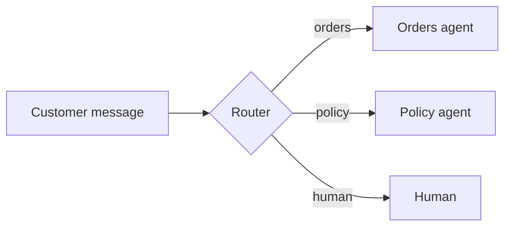
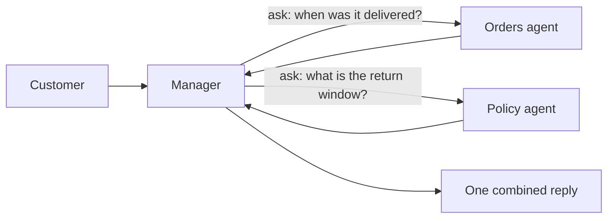
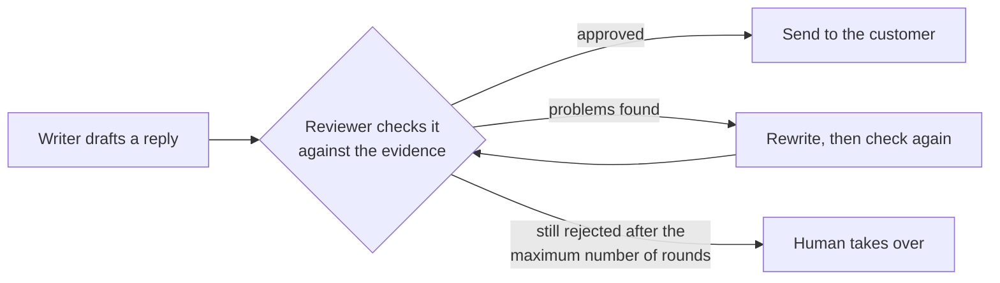
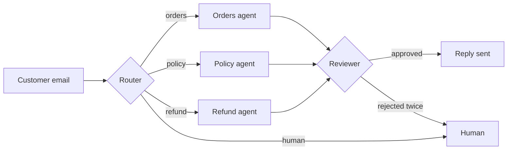

# Module 04 · Multi-Agent Architectures: a team instead of one assistant

At the end of Module 03, one assistant had a long prompt, several tools, a knowledge base and a memory. It works, but one agent doing everything gets harder to **control, test and trust** as the job grows.

This module builds a **team of small agents**, each with one clear job, and makes them work together. We keep using the same online shop.

Read this page first, then work through the notebooks in order.

**On this page**
[Why more than one agent?](#why-more-than-one-agent) · [What is an agent, in code?](#what-is-an-agent-in-code) · [Pattern 1: router](#pattern-1-router-and-handoff) · [Pattern 2: manager](#pattern-2-manager-and-workers) · [Pattern 3: reviewer](#pattern-3-writer-and-reviewer) · [Putting it together](#putting-it-together) · [Rules of thumb](#rules-of-thumb) · [The notebooks](#the-notebooks)

---

## Why more than one agent?

| Problem with one big agent | What small specialists give you |
|---|---|
| **Long instructions.** Every rule is sent on every call, which costs tokens and can confuse the model. | Short, focused instructions per agent |
| **Many tools.** The more tools to choose from, the easier it is to pick the wrong one. | Each agent sees only 1 to 3 tools |
| **Too much power.** The agent answering a shipping question can also issue refunds. | Only the agents that need `issue_refund` get it |
| **Hard to test.** When something goes wrong, which rule failed? | Test and fix one agent at a time |
| **One model for everything.** | A cheap model for easy jobs, a stronger one where it matters |

> [!WARNING]
> **More agents is not always better.** Every extra agent means more model calls, more cost, more delay and more places to fail. If one agent with a few tools does the job well, keep it. Split only when a single agent becomes hard to control.

---

## What is an agent, in code?

Just four things, stored in a plain Python dictionary:

| Part | Example |
|---|---|
| **name** | `"Orders agent"` |
| **instructions** | "You are the Orders specialist. Use lookup_order. Do not answer policy questions." |
| **tools** | The descriptions of the tools it may use |
| **functions** | The real Python functions behind those tools |

One function, `run_agent`, can run **any** agent, because everything that makes them different is in the dictionary. A good specialist's instructions also say what it must **not** do, so it stays in its lane.

---

## Pattern 1: Router and handoff

A **router** reads each message and **hands it over** to the right specialist. It does not answer anything itself.



The router uses **structured output** (Module 02) so that its answer is one of a fixed list. Plain Python then reads the choice and passes the message on. Always include a **human** route for what the agents should not handle, such as an angry customer or a legal threat.

---

## Pattern 2: Manager and workers

Some questions need **several** specialists: "Can I still return order A1001, and how long until I get my money back?" needs the Orders agent (when was it delivered?) and the Policy agent (what is the return window?).

A **manager** agent knows nothing itself. Its tools are its **colleagues**. It asks each specialist a question and combines the answers.



Nothing new is needed to build this. An agent used as a tool is just a function that calls `run_agent`.

| | Router | Manager |
|---|---|---|
| Specialists used | **One** per message | **Several** per message |
| Who decides | A separate routing step | The manager, using its tools |
| Best for | Clear, single-topic messages | Questions that mix topics |
| Cost | Fewer model calls | More model calls |

---

## Pattern 3: Writer and reviewer

A model can write a friendly reply that **promises something the shop does not allow**, such as a refund outside the refund window. So one agent **writes**, and a second agent **reviews** before anything is sent.



- The reviewer compares the draft with **evidence**: what the tools actually returned, not its own opinion.
- A **round limit** and a **human fallback** stop the loop from running forever.
- Only the **wording** is rewritten. The tools are not run again, so an action like a refund can never happen twice.
- The reviewer is an extra model call, so use it where a mistake is costly: refunds, legal wording, medical advice.

---

## Putting it together

The real-life script, `support_desk.py`, uses all three patterns for every customer email:



| Agent | Job | Tools | Model |
|---|---|---|---|
| Router | Pick the right specialist | none (structured output) | `gpt-4o-mini` |
| Orders agent | Order status and details | `lookup_order` | `gpt-4o-mini` |
| Policy agent | Shop rules, from the knowledge base | `search_policies` | `gpt-4o-mini` |
| Refund agent | Refund requests. **The only agent that can issue a refund.** | `lookup_order`, `check_refund_eligibility`, `issue_refund` | `gpt-4o-mini` |
| Reviewer | Check the reply against the evidence | none | `gpt-4o`, a stronger model for the most important job |

---

## Rules of thumb

- **One clear job per agent.** If you cannot describe an agent's job in one sentence, split it.
- **Only the tools it needs.** Keep powerful tools such as refunds away from agents that do not need them.
- **Say what each agent must not do.** It keeps specialists in their lane.
- **Cap the rounds.** Every loop has a maximum, and a human takes over when it is reached.
- **Log every handoff.** The `[Router]`, `[Orders agent]` and `[Reviewer]` lines in the output show who did what. When something goes wrong, you can see where.
- **Do not run actions twice.** When a reply is rewritten, do not run the agent's tools again. Make action tools safe to repeat as well: the refund tool refuses to refund the same order twice.
- **Use a stronger model where mistakes are costly.** A cheap model for routing and simple answers, a better one for review.
- **Reviewers are not perfect either.** A reviewer is another model and can be wrong. Test it on bad drafts you wrote yourself, and keep a human fallback.
- **Check whether you need more than one agent.** If one agent copes, keep it.

> Frameworks such as LangGraph and CrewAI wrap these same patterns. Once you understand the plain-Python version, those tools will make sense.

---

## The notebooks

All of them use only the OpenAI API and plain Python. The shop's data, tools and the `run_agent` function are in [shop.py](shop.py), reused from Modules 02 and 03, so each notebook can focus on the new idea.

| # | Notebook | You will learn |
|---|---|---|
| 1 | [01_WhyMultipleAgents.ipynb](01_WhyMultipleAgents.ipynb) | What a do-everything agent costs: 337 input tokens against 92 for a specialist on the same question |
| 2 | [02_SpecialistAgents.ipynb](02_SpecialistAgents.ipynb) | An agent is a dictionary. Build an Orders agent and a Policy agent and see them stay in their lane. |
| 3 | [03_RouterAndHandoff.ipynb](03_RouterAndHandoff.ipynb) | A router chooses the specialist with structured output, and hands an angry customer to a human |
| 4 | [04_ManagerAndWorkers.ipynb](04_ManagerAndWorkers.ipynb) | A manager agent uses specialists as tools and combines their answers |
| 5 | [05_WriterAndReviewer.ipynb](05_WriterAndReviewer.ipynb) | A reviewer rejects a bad draft. Then a write, review, revise loop with a round limit. |

**A real-life example:** [support_desk.py](support_desk.py) is the shop's support desk. It handles five customer emails: an eligible refund, a policy question, an order status question, a refund that is outside the 30-day window, and an angry customer who goes straight to a human.

```powershell
python "Multi-Agent Architectures/support_desk.py"
```

You can also try your own email: `python support_desk.py "Hi, where is my order A1002?"`

**Setup:** the same as before. You need `OPENAI_API_KEY` in your `.env` file. Each notebook and the script make only a handful of small calls. The reviewer uses `gpt-4o`, which costs more per call than `gpt-4o-mini` but is still a fraction of a cent here.

---

**Next: Module 05, Agent Guardrails & Evals.** Our reviewer is a first guardrail. Next we look at the dangers around agents in a systematic way: filtering bad input, limiting what agents can do, and measuring whether an agent really works with tests that you can run again after every change.

*Agentic AI: From Zero to Live Production · Module 04 · [Rohit Nirantar](https://github.com/rohitnirantar)*
