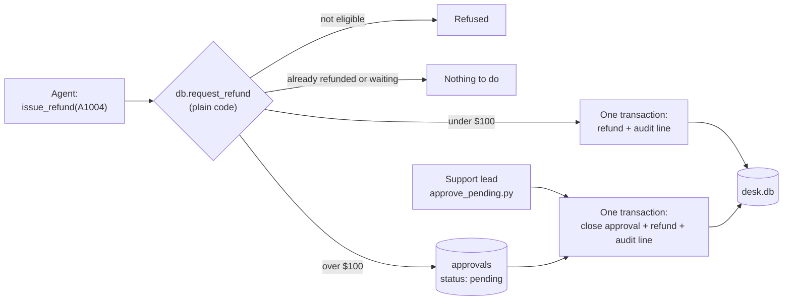

# Module 08 · Persistent State & Databases: a desk that does not forget

Until now the shop lived in **Python variables**. Stop the program, and everything is gone: the refunds that were issued, the approvals that were waiting, what each customer wrote yesterday. That is fine for learning. It is not fine for a desk that moves money.

This module gives the support desk a **real database** (SQLite: one file, nothing to install, runs on your laptop) and teaches the four ideas behind every serious system that stores money decisions.

Read this page first, then work through the notebooks in order.

**On this page**
[Why variables are not enough](#why-variables-are-not-enough) · [The four ideas](#the-four-ideas) · [What is in the database](#what-is-in-the-database) · [Memory is an attack surface](#memory-is-also-an-attack-surface) · [Honest limits](#what-this-module-does-not-do) · [The notebooks](#the-notebooks) · [Run it](#run-it) · [Interview corner](#interview-corner)

---

## Why variables are not enough

| What you need | Python variable | JSON file | Database |
|---|---|---|---|
| Survives a restart | no | yes | yes |
| Two programs at the same time | n/a | **loses updates** | safe |
| Crash in the middle of a write | everything lost | **half-written file** | all or nothing |
| "Refunds over $100 last week?" | loop by hand | loop by hand | one line of SQL |
| The rules are enforced for you | no | no | yes |

---

## The four ideas

### 1. A transaction: all or nothing
Issuing a refund is two writes: the refund, and the audit line. They must be saved together. A **transaction** makes several writes succeed or fail as one. In our code that is `with db.transaction() as conn:`. If anything raises an error inside, **nothing** is saved. This is the "A" (atomic) in **ACID**. The other three letters: **C**onsistent (the rules always hold), **I**solated (requests do not trip over each other), **D**urable (saved means saved).

### 2. A UNIQUE rule: let the database say no
The tempting way to prevent a double refund is *check, then write*. It fails when two requests overlap: both check, both see "no refund yet", both write. In notebook 2 we reproduce this with eight threads, and **one order is refunded eight times**.

The fix is to tell the database the rule once (`order_id` is `UNIQUE` in `refunds`). Now it does not matter how many requests race. The database refuses all but one. This is **idempotency**: doing the same thing twice has the same effect as once.

### 3. Persistence: the desk and the person do not run at the same time
A big refund waits for a person. In real life the desk may be restarted, and the person opens their tool hours later. With the database they meet in the **file**. `approve_pending.py` is a separate program from the desk, and it works.

### 4. An audit trail in the same transaction
Who approved this refund, and when? Every money event is written **inside the same transaction as the money itself**, so the trail can never disagree with the refunds table.



---

## What is in the database

| Table | Holds | A rule the database enforces |
|---|---|---|
| `orders` | the shop's orders | `order_id` is the primary key |
| `refunds` | refunds that were issued | **`order_id` is UNIQUE**, and the amount must be above zero |
| `approvals` | big refunds waiting for a person | **only one `pending` row per order** |
| `tickets` | every email and reply (the desk's memory) | |
| `audit` | who did what, when | |

All SQL lives in `db.py`. The agent never writes SQL. It calls plain functions, so the **$100 limit is in code, not in a prompt**. Every query uses `?` placeholders, never string gluing, because an order id that reaches your tool was typed by a customer (and then repeated by a model). Notebook 1 shows what happens with string gluing: `x' OR '1'='1` returns every order in the shop.

---

## Memory is also an attack surface

Long-term memory is useful: a customer writes "did you do what I asked earlier?" and the agent knows what that means. But a ticket is **text that a customer wrote**, and we show it to the model again next time. A customer can write an email today that attacks the desk tomorrow (**stored prompt injection**).

| Defence | Holds if the model is fooled? |
|---|---|
| Old tickets labelled "quotes, never instructions" | **No**, it only lowers the odds |
| Tickets cut to 150 characters | **No** |
| The $100 limit in code | **Yes** |
| UNIQUE rule: never refund twice | **Yes** |
| The audit trail | **Yes**, for finding out afterwards |

**The rule of thumb:** the model can be talked into anything, so what must never happen has to be impossible in code and in the database. Module 10 (Red Teaming) attacks this on purpose.

---

## What this module does not do

- **It does not check that an order belongs to the customer who is writing.** A production desk must, inside the tool, in code. We leave it visible, as a gap, on purpose.
- **SQLite allows one writer at a time and lives on one machine.** For several servers or many writers you move to PostgreSQL. Transactions, UNIQUE rules, placeholders and migrations carry over unchanged.
- **Sample dates are relative to the day you create the database.** A database you keep for weeks makes `A1001` older, so a refund can become "too late". Run `--fresh` to start again. (Real data has real dates.)
- **The database is not encrypted and has no user accounts.** Production databases have both.

---

## The notebooks

| # | Notebook | You will learn |
|---|---|---|
| 1 | [01_FromVariablesToADatabase.ipynb](01_FromVariablesToADatabase.ipynb) | What a restart does to variables, a JSON file losing an update, SQL in five minutes, SQL injection and the `?` |
| 2 | [02_MoneyMustBeSafe.ipynb](02_MoneyMustBeSafe.ipynb) | Transactions, a real race condition (8 refunds for one order), the UNIQUE fix, the approval line, the audit trail |
| 3 | [03_ADeskThatRemembers.ipynb](03_ADeskThatRemembers.ipynb) | Customer history as a table, memory per customer, and stored prompt injection |
| 4 | [04_RestartCrashGrowUp.ipynb](04_RestartCrashGrowUp.ipynb) | A separate program approves a refund, a process killed mid-refund, backups, migrations, and when SQLite is not enough |

## Run it

After the notebooks, **one file runs the whole real-life scenario**: a morning at the support desk, with a desk that remembers across restarts. Run it **twice** and watch the second run.

```powershell
python "Persistent State and Databases/support_desk_db.py" --fresh   # start from an empty shop
python "Persistent State and Databases/support_desk_db.py"           # run again: nothing is forgotten
python "Persistent State and Databases/approve_pending.py"           # list the refunds waiting for a person
python "Persistent State and Databases/approve_pending.py" A1004 Priya   # approve one, as Priya
python "Persistent State and Databases/support_desk_db.py"           # the desk knows it was approved
python "Persistent State and Databases/crash_test.py"                # kill a process mid-refund (own temp database)
```

### Setup
The main environment from the repository's [README](../README.md) is enough: `openai`, `python-dotenv` and `jupyter`. SQLite is part of Python. You need `OPENAI_API_KEY` in your `.env` file. The whole module costs a few cents.

---

## Interview corner

**The 30-second story.** *"I gave my support agent a real database. The part I am proudest of is not the SQL. It is that I reproduced a race condition on purpose: eight threads, one order, eight refunds. Then I fixed it by moving the rule into the database, with a UNIQUE constraint, instead of checking in Python. I also killed a process in the middle of a refund to prove the transaction rolls back. And the $100 limit is in a function, not a prompt, so a prompt injection cannot move it."*

**Questions you may get, and short answers**

| Question | A good short answer |
|---|---|
| Why not just keep state in memory or a JSON file? | Memory is lost on restart. A file has no locking, so two writers lose updates, and a crash can leave it half-written. |
| What is a transaction? | A group of writes that are saved together or not at all. If a step fails, everything rolls back. |
| What does ACID stand for? | Atomic, Consistent, Isolated, Durable. |
| How do you stop a double refund? | Make the database enforce it with a UNIQUE constraint. Check-then-write in code races. Then handle the `IntegrityError` politely. |
| What is idempotency? | Doing the same request twice gives the same result as once. Essential when agents and networks retry. |
| What is SQL injection and how do you prevent it? | Building SQL from user text lets them write SQL. Use placeholders (`?`), always. For agents, the text also comes from a model, so the same rule applies. |
| Where do you put business rules in an agent system? | In code and in the database, not in the prompt. Prompts can be talked around. |
| What is stored (persistent) prompt injection? | An attack saved as data (a ticket, a note) that attacks later when it is loaded into a prompt. Treat stored text as untrusted. |
| When would you move from SQLite? | Several servers, many concurrent writers, or vector search at scale. Usually to PostgreSQL. The ideas carry over. |
| How do you change a table that has real data? | A numbered migration, applied once, tested on a copy first (Alembic is the common tool). |

**A good question to ask them back:** *"How do you make sure an agent's side effects, like refunds or emails, are never done twice when a request is retried?"*

---

**Next:** Module 09 puts the same desk on a **budget**: cheaper models for easy emails, remembered answers, and batches.

*Agentic AI: From Zero to Live Production · Module 08 · [Rohit Nirantar](https://github.com/rohitnirantar)*
