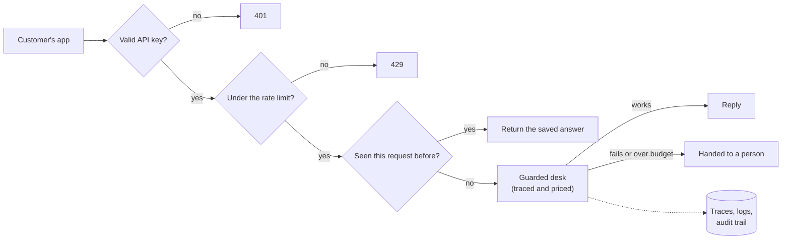
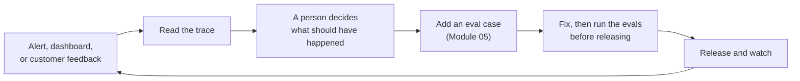

# Module 07 · Production & Observability: run it for real, and know what it is doing

By the end of Module 05 the support desk was capable and guarded. But a desk that works on your laptop is not yet a service. Real customers arrive at any hour. Things fail in ordinary ways. And when something goes wrong at 3 a.m., you need to be able to find out **what happened, how long it took, what it cost, and whether it was any good**.

This module has two halves:

1. **Production**: put the desk behind an API, make it reliable, and run it for real **without Docker**.
2. **Observability**: record what happens inside every request, turn those records into numbers and alerts, and feed real problems back into your tests.

We keep using the same online shop. Read this page first, then work through the notebooks in order.

**On this page**
[What changes in production](#what-changes-in-production) · [The service](#the-service) · [Reliability](#reliability) · [Observability](#observability-what-to-record-and-why) · [A trace](#what-a-trace-looks-like) · [Alerts and the loop](#alerts-and-closing-the-loop) · [Going live](#going-live-without-docker) · [Honest limits](#what-this-module-does-not-do) · [Rules of thumb](#rules-of-thumb) · [The notebooks](#the-notebooks)

---

## What changes in production

| On your laptop | In production |
|---|---|
| You call a Python function | Other programs call a **web address** |
| You watch the output | **Nobody is watching**, so the system must record itself |
| A failure is an error message | A failure is a **customer** who got nothing |
| One request at a time | The same request can arrive twice, or ten thousand times |
| A call that costs a cent is nothing | A call that costs a cent, **repeated**, is a bill |

---

## The service

The desk becomes a **FastAPI** service. Every request passes through a few gates before it reaches the desk.



| Endpoint | Who | What it does |
|---|---|---|
| `POST /emails` | Customer's app | Send an email, get a reply, a request id, the cost and the latency |
| `POST /feedback` | Customer's app | Thumbs up or down on a reply |
| `GET /approvals`, `POST /approvals/{id}/approve` | Staff | See and approve refunds above the automatic limit |
| `POST /kill-switch` | Staff | Switch the AI off, so every email goes to a person |
| `GET /metrics` | Staff | The numbers and any alerts |
| `GET /health` | Hosting platform | "Are you alive?" |

---

## Reliability

Things go wrong in ordinary ways. A reliable service **expects** them.

| What goes wrong | The defence |
|---|---|
| OpenAI says "slow down" (429), or a server hiccups | **Retries with backoff**: wait, then wait longer, with a limit |
| A call hangs | A **timeout** on everything that waits |
| The same request arrives twice (a double click, a retry) | **Idempotency keys**: repeat requests get the saved answer, so no second refund |
| One request spends far too much | A **cost budget per request**, checked before every paid call |
| The AI provider is down | A **fallback**: the email goes to a person, not an error page |
| One caller floods the service | A **rate limit** per key |
| Something is clearly wrong | A **kill switch** that sends everything to people at once |

Notice the pattern from Module 05: **layer the protections**. The idempotency key *and* the refund tool's own duplicate check both protect the money.

---

## Observability: what to record, and why

**Observability** means you can answer questions about your system **after the fact**, from the data it recorded. For an AI agent that means more than error logs.

| What to record | Why it matters for agents | Where in this module |
|---|---|---|
| **Logs** as structured JSON with a **request id** | A machine can search them, and one id ties together every line of a request | Notebook 3 |
| **Traces** made of timed **spans** | One email makes many model and tool calls. You need to see the whole chain | Notebook 3 |
| **Cost** per call, request, stage, model and day | A looping agent can spend real money | Notebooks 3 and 4 |
| **Latency** as percentiles (p50, p95) and **per stage** | "Slow" is useless. You need to know *which step* is slow | Notebook 4 |
| **Quality**: a judge model on a **sample**, plus customer thumbs | Agents fail quietly: a fluent wrong answer raises no error | Notebook 4 |
| **Behaviour signals**: block rate, human rate, reply rewrites | A sudden change often means a problem or an attack | Notebook 4 |
| **Privacy**: redact personal data **before** logging | Logs live long and many people can read them | Notebook 3 |
| **Versions**: model, prompt version, code version | "It got worse on Tuesday" becomes a diff | Notebook 3 |
| **An audit trail** of actions that move money | "Who approved this refund?" must have an answer | Notebooks 3 and 5 |
| **Alerts** with limits, owners and a checklist | Nobody watches a dashboard at 3 a.m. | Notebook 5 |
| **Replay**: turning a real failure into an eval case | The test suite grows with every incident | Notebook 5 |

We build all of this **by hand, in plain Python** (`observe.py`, `metrics.py`), so you see how it works. Real products (OpenTelemetry, Langfuse, LangSmith, Arize Phoenix, and your OpenAI dashboard) are built on the **same ideas**, so afterwards you can read any of them. Notebook 3 shows how to also send calls to **OpenAI's own dashboard**, and what data that uploads.

> **Observability costs money too.** Grading every reply with a judge model can cost as much as serving the customers. So we grade a **sample**.

---

## What a trace looks like

A **trace** is the record of one request. It is made of **spans**: timed steps that can nest. This is a real one from the desk (an order-status question):

```text
Trace 64bef9737e09  6803 ms  6 model calls  $0.00157
  input_guards                      2310 ms
    moderation:omni-moderation-latest  1022 ms  0 in / 0 out  $0.00000
    chat:gpt-4o-mini                1288 ms  157 in / 48 out  $0.00005
  router                            1042 ms
    chat:gpt-4o-mini                1042 ms  152 in / 20 out  $0.00003
  agent:Orders agent                2219 ms
    chat:gpt-4o-mini                1063 ms  136 in / 17 out  $0.00003
    tool:lookup_order                  0 ms
    chat:gpt-4o-mini                1156 ms  196 in / 40 out  $0.00005
  output_guard                      1232 ms
    chat:gpt-4o                     1232 ms  269 in / 73 out  $0.00140
```

Read it as a story, and it tells you things you could never see from the reply alone: the **reviewer is almost 90% of the cost** of this email, and **every step waits for the previous one**. Those facts turn guesses into decisions.

---

## Alerts and closing the loop

An **alert** is a limit on a number: *if this crosses that, tell a person.* A good alert says **what** crossed **which** limit, goes to a **named owner**, and comes with a **checklist**.

The most valuable habit of the module is **closing the loop**:



Every real failure becomes a **free test case**. Over time the desk gets better by running, instead of slowly decaying.

---

## Going live without Docker

You do not need Docker to run a Python service. A **hosting platform** can build your project straight from your GitHub repository, using your `requirements.txt` and a **start command** (`uvicorn desk_service:app --host 0.0.0.0 --port $PORT`). Notebook 6 gives the recipe and a checklist.

It also covers:
- **Settings and secrets** in environment variables, and a service that **refuses to start** in production with the public development keys
- **API keys** at two levels (customer and admin), and **rate limiting**
- **A release gate**: an example GitHub Actions file that runs the Module 05 evals before every release (saved as `ci/evals.yml.example`, so it is not active until you choose)
- **Safe releases**: small changes, versions in the logs, a way back

> Deploying *publishes* a service that spends your OpenAI money on the internet, and needs an account of yours. So the module gives you the recipe, and the final click is yours.

---

## What this module does **not** do

Honesty about limits is part of production work.

- The desk keeps its **state in memory** (the refund list, the approval queue, the idempotency answers). A restart forgets it, and the service must run as **one process**. A real system uses a **database** (and something like Redis for shared counters).
- It handles **one email at a time**, because of that shared state.
- API keys are the simplest authentication. Apps with real users need logins.
- No Docker, Kubernetes or load testing.

---

## Rules of thumb

- **Settings and secrets come from the environment**, never from the code. Fail loudly at startup if they are missing or well-known.
- **Timeouts on everything. Retry only temporary errors, with backoff and a limit.**
- **Every action that changes something is idempotent**, especially money.
- **Every request gets a budget.** Decide the fallback in advance: "a person answers".
- **Trace first, optimise second.** Know where the money and the time go.
- **Percentiles, not just averages.**
- **Redact personal data before it reaches a log.**
- **Log the version** of the model, the prompt and the code.
- **Two quality signals**: a judge on a sample, and the customers. Read real examples every week.
- **Have a kill switch, and practise using it.**
- **Every real failure becomes an eval case.**

---

## The notebooks

All of them use only the OpenAI API and plain Python, plus FastAPI for the service. The desk is in [shop.py](shop.py), [guards.py](guards.py) and [desk.py](desk.py) (from Module 05, now with a span around every stage). The new code is in [observe.py](observe.py), [reliability.py](reliability.py), [quality.py](quality.py), [metrics.py](metrics.py) and [desk_service.py](desk_service.py).

| # | Notebook | You will learn |
|---|---|---|
| 1 | [01_PutTheDeskBehindAnAPI.ipynb](01_PutTheDeskBehindAnAPI.ipynb) | What an API is, a tiny FastAPI app, then the desk as a service with validation, a fallback and human approval |
| 2 | [02_MakeItReliable.ipynb](02_MakeItReliable.ipynb) | Timeouts and retries, backoff by hand, a fallback, idempotency for refunds, and a cost cap per request |
| 3 | [03_LoggingAndTracing.ipynb](03_LoggingAndTracing.ipynb) | Structured logs, a request id, traces and spans, automatic cost tracking, redaction, versions, an audit trail, and OpenAI's dashboard |
| 4 | [04_CostSpeedAndQuality.ipynb](04_CostSpeedAndQuality.ipynb) | Real logs turned into numbers: where money and time go, percentiles, guardrail rates, a judge and customer feedback |
| 5 | [05_AlertsAndClosingTheLoop.ipynb](05_AlertsAndClosingTheLoop.ipynb) | Alerts, the kill switch, an incident checklist, and turning a real failure into an eval case |
| 6 | [06_GoingLiveWithoutDocker.ipynb](06_GoingLiveWithoutDocker.ipynb) | Secrets, API keys, rate limiting, running a real server, the hosting recipe and a release gate |

**Real-life examples:** a morning of customer emails goes through the service, and then the person on call reads the logs.

| Script | What it does |
|---|---|
| [desk_service.py](desk_service.py) | The service itself. Run it, then open `http://127.0.0.1:8000/docs` to try every endpoint |
| [simulate_traffic.py](simulate_traffic.py) | 16 emails: ordinary questions, refunds, a retried request, attacks, a huge email, an angry customer, ratings, and a human approving the big refund |
| [ops_report.py](ops_report.py) | The person on call: dashboard, alerts, requests worth a look, the slowest request as a trace, and the audit trail. Free to run |
| [openai_traces_demo.py](openai_traces_demo.py) | *Optional.* One agent run that appears in OpenAI's Traces dashboard (needs the Module 06 environment) |

```powershell
python "Production and Observability/desk_service.py"          # the service (leave it running)
python "Production and Observability/simulate_traffic.py"       # a morning of traffic
python "Production and Observability/ops_report.py"            # what do the logs say?
```

`simulate_traffic.py` runs the service inside itself, so you do not need the server running to try it. The folder `sample_logs/` holds real logs from two runs of it. Notebooks 4 and 5 analyse them, so you can learn the metrics without spending anything.

### Setup
Same environment as Modules 01 to 05 (the main `venv`). Three packages are new:

```powershell
pip install -r "Production and Observability/requirements.txt"
```

You need `OPENAI_API_KEY` in your `.env` file. Running the notebooks and scripts costs a few cents. The files the service writes go to a `logs/` folder, which git ignores.

---

**Next: the capstone.** The support desk in each framework from Module 06, with the Module 05 guardrails and this module's tracing around every one, scored with the same evals, and compared on real numbers.

*Agentic AI: From Zero to Live Production · Module 07 · [Rohit Nirantar](https://github.com/rohitnirantar)*
