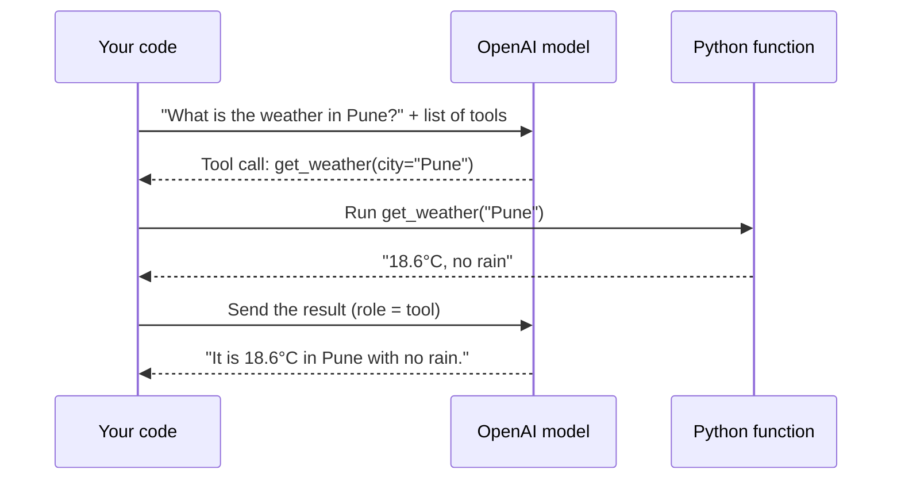
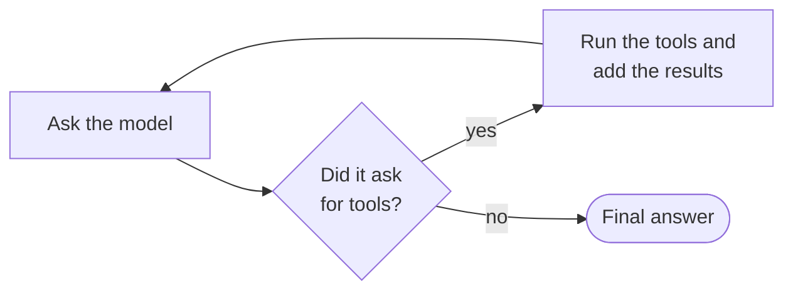

# Module 02 · Tool Calling & Integrations: from talking to doing

In Module 01 the model could only **talk**. In this module it starts to **do things**: check the weather, do a calculation, call an API. This is the step that turns a chatbot into an agent.

Read this page first, then work through the notebooks in order.

**On this page**
[What is a tool?](#what-is-a-tool) · [The round trip](#the-round-trip) · [How the model knows about your tool](#how-the-model-knows-about-your-tool) · [Structured output](#structured-output) · [From tool calls to an agent](#from-tool-calls-to-an-agent) · [Rules of thumb](#rules-of-thumb) · [The notebooks](#the-notebooks)

---

## What is a tool?

A tool is a normal function in your code, such as `get_weather(city)`. You describe it to the model, and the model can then **ask you to run it**.

> [!IMPORTANT]
> **The model never runs the function.** It only returns a request like "please call `get_weather` with `city = Pune`". Your code runs it and sends the result back.

Think of a manager (the model) who can only write notes. Your code is the assistant who reads the note, does the job, and reports back.

---

## The round trip

One question that uses a tool takes **two model calls**.

This is where the `tool` role from Module 01's message table finally gets used.

| Role | Who writes it | In this module |
|---|---|---|
| `user` | The person | The question |
| `assistant` | The model | The tool request, then the final answer |
| `tool` | **Your code** | The result of running the function |

---

## How the model knows about your tool

The model cannot read your Python code. You give it a short description with three parts:

| Part | Example | Why it matters |
|---|---|---|
| **Name** | `get_weather` | How the model refers to the tool |
| **Description** | "Get the current weather for a city." | The model reads this to decide **when** to use the tool |
| **Inputs** | `city` (text, required) | Tells the model what to fill in |

The description is the most important part. A vague description means the model picks the wrong tool, or never picks it.

The model also decides **whether** to use a tool at all. "What is the capital of France?" needs no tool, so it just answers.

---

## Structured output

A tool call is really **structured data**: a tool name plus inputs in an exact shape. Structured output is the same idea used on its own. You describe the shape you want, and the model returns fields with types instead of a paragraph.

| Free text | Structured output |
|---|---|
| "The customer ordered some blue t-shirts, about three, and sounds in a hurry." | `item="blue t-shirt"`, `quantity=3`, `is_urgent=True` |
| Hard for code to use | Ready to use in `if` statements and maths |

---

## From tool calls to an agent

Sometimes one round is not enough. "What is 10% of the current temperature in Pune?" needs the weather **first**, and only then the calculation. The model has to go round more than once.

An agent is just that: a loop.

This is the Think, Act, Observe loop from Module 01. In the last notebook you write it yourself in about 20 lines of plain Python.

---

## Rules of thumb

- **Write clear descriptions.** The model chooses tools by reading them.
- **Keep each tool small and safe.** A `percentage_of` function is better than a tool that runs any maths text. Never give a model a tool that runs arbitrary shell commands or database queries.
- **Treat the model's inputs as untrusted.** It fills them in by itself and can get them wrong. Check them before a tool does anything that matters, like deleting data or spending money.
- **Return errors as text.** If a tool fails, tell the model what went wrong instead of crashing.
- **Limit the loop.** Every lap is a model call and costs tokens (see Module 01). Always set a maximum number of steps.

---

## The notebooks

All five use only the OpenAI API and plain Python, with no extra frameworks.

| # | Notebook | You will learn |
|---|---|---|
| 1 | [01_StructuredOutput.ipynb](01_StructuredOutput.ipynb) | Get fields with types back instead of free text |
| 2 | [02_FirstToolCall.ipynb](02_FirstToolCall.ipynb) | The full round trip, step by step, with one fake tool |
| 3 | [03_RealAPITool.ipynb](03_RealAPITool.ipynb) | Swap in a real, free weather API (no key needed) |
| 4 | [04_MultipleTools.ipynb](04_MultipleTools.ipynb) | Give the model three tools and let it choose |
| 5 | [05_MiniAgentLoop.ipynb](05_MiniAgentLoop.ipynb) | Build a small agent that can use tools over several steps |

Want it all in one place? [simple_agent.py](simple_agent.py) combines structured output, the three tools and the agent loop in a single script you can run with `python simple_agent.py`.

**Setup:** the same as Module 01. You need `OPENAI_API_KEY` in your `.env` file (copy `.env.example` if you have not yet). Each notebook makes a handful of small calls, which costs a fraction of a cent.

---

**Next: Module 03, Agent Memory & Retrieval.** Right now every question starts from a blank page. Next the agent will remember earlier conversations and look things up in your own documents.

*Agentic AI: From Zero to Live Production · Module 02 · [Rohit Nirantar](https://github.com/rohitnirantar)*
